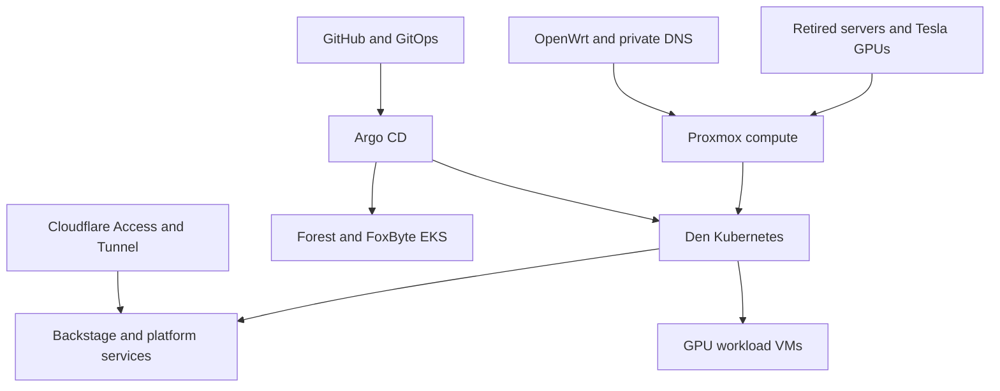

# Forest Reforge

### Retired hardware. Modern infrastructure. A second life, engineered.

**Build a hybrid datacenter from the machines the industry left behind.**

Forest Reforge combines a field guide and configuration toolkit for turning second-hand enterprise servers, passive NVIDIA Tesla accelerators, modest networking equipment, and a home rack into a platform for virtual machines, Kubernetes, AI workloads, and AWS-connected services.

Born in **Mr. Foxxo’s den**, part of Enchanted Forest Inc., it follows the whole path: rails and airflow → trustworthy hardware → isolated networks → virtual compute → Kubernetes → identity → GitOps → cloud integration → recovery.

Match each machine to useful work, record the configuration and results, and keep a clear recovery path.

> **Platform and automation · 2026-10-28.** Built from the operating Den platform and backed by recorded evidence, automated tests, Ansible syntax checks and rendered configuration checks. Explore the [Den platform record](docs/den-case-study.md), [validations and experiments](docs/den-validations-experiments.md), [validation report](docs/package-validation.md) and [setup guide](docs/automation.md).

## What you can build

- A physically segmented lab using OpenWrt and separate switches, without requiring VLAN trunks.
- Proxmox hosts with recoverable upgrade procedures and a deliberate GPU passthrough/vGPU strategy.
- A kubeadm cluster with Cilium, kube-vip, Gateway API, TLS, local storage, and observability.
- A developer portal with GitHub organization identity and Cloudflare Access.
- An on-prem Argo CD control point for local workloads and separate AWS EKS targets.
- A legacy GPU compute pool with versioned workload and benchmark records.

## Start here

1. Read the [architecture and evidence policy](docs/architecture.md).
2. Choose a [build path](docs/build-paths.md); you do not need two servers or AWS to begin.
3. Fill in the [site contract](examples/site-contract.md) and [version record](examples/validated-stack.md).
4. Follow the modules in dependency order below.
5. Run the [acceptance and recovery exercises](docs/acceptance.md).

The [automation guide](docs/automation.md) provides phased setup commands, private inventory/vault examples, service prerequisites, AWS access/ECR renewal, recovery and rollback guidance. The [reference-to-automation map](docs/automation-source-map.md) explains what was carried forward from the source playbooks and chats. Target versions and credentials are deliberate local inputs.

Choose the smaller [new-build inventory](automation/ansible/inventory.example.yml) or the [Den-sized inventory](automation/ansible/inventory.observed.example.yml), then supply your private addressing, credentials and version selections. Run [cluster-resources.py](scripts/cluster-resources.py) to collect and compare current Node resources in an existing cluster.

## The modules

| Module | What it teaches | Exit condition |
|---|---|---|
| [01 · Roots](modules/01-roots-physical.md) | Rack, power, cooling, cabling, reused hardware | Stable physical platform and inventory |
| [02 · Forge](modules/02-forge-hardware.md) | R710, X99, RAM, firmware, OOB recovery | Hardware passes repeatable tests |
| [03 · Paths](modules/03-paths-network.md) | OpenWrt zones, routing, WireGuard | Allowed and forbidden paths tested |
| [04 · Names](modules/04-names-dns-tls.md) | Split DNS, ACME, wildcard boundaries | Trusted canonical names |
| [05 · Burrows](modules/05-burrows-proxmox.md) | Hypervisors, VM templates, storage | Restorable guests |
| [06 · Embers](modules/06-embers-gpu.md) | Tesla P4/V100/M40, CUDA, passthrough, vGPU | One recorded working GPU stack |
| [07 · Canopy](modules/07-canopy-kubernetes.md) | kubeadm, Cilium, VIPs, Gateway API | Cluster and external route acceptance |
| [08 · Vault](modules/08-vault-storage-secrets.md) | LocalPV, data services, secret ownership | Restore and rotation demonstrated |
| [09 · Gatehouse](modules/09-gatehouse-identity-edge.md) | GitHub, Cloudflare, application identity | Login and rejection both proven |
| [10 · Trails](modules/10-trails-gitops-backstage.md) | Argo CD, Backstage, delivery ownership | Commit becomes an authorized deployment |
| [11 · Skybridge](modules/11-skybridge-aws.md) | AWS accounts, VPN, EKS, ECR | Least-privilege cross-account delivery |
| [12 · Lookout](modules/12-lookout-operations.md) | Metrics, logging, backup, cost, upgrades | Recovery works without the portal |
| [13 · Spellwork](modules/13-spellwork-ai.md) | Legacy GPU inference and benchmark design | Reproducible workload results |

## The hardware at the heart of the project

| Resource | Role in the originating den | Reuse lesson |
|---|---|---|
| Dell PowerEdge R710, dual X5690 | Foundational virtualization and Tesla P4 integration | CPU instruction set, risers and cooling matter |
| Dual-socket X99 host | Larger compute host, Tesla V100 | Qualify mixed memory before software debugging |
| NVIDIA Tesla P4 | Compact Pascal compute | Official vGPU support ends at branch 16 |
| NVIDIA Tesla V100 | Volta compute | Current AI packages can still exclude it |
| NVIDIA Tesla M40 | Additional Maxwell compute capacity | No official NVIDIA vGPU support; evaluate passthrough |
| Banana Pi R3 + Raspberry Pi 4 | Routing/firewall and independent DNS | Keep recovery dependencies outside Kubernetes |
| Separate switches | Physical trust boundaries | Simple segmentation can be sufficient |

Read the [compatibility matrix](docs/compatibility.md) before buying or installing. GPU generation, driver branch, hypervisor kernel, guest OS, CUDA build, and application kernels form one compatibility chain.

## Platform and verification

The [Den platform record](docs/den-case-study.md) and [machine-readable snapshot](examples/observed-platform.json) document the operating hardware and Kubernetes resources. The [validation report](docs/package-validation.md) records the repository checks and how to reproduce them.

| Area | Recorded verification |
|---|---|
| Physical infrastructure | Four Proxmox hypervisors and a TrueNAS system across 17 reviewed source views |
| Runtime and placement | Thirteen guests mapped across two standalone hosts; cluster and Argo workload screenshots versioned in assets |
| Kubernetes nodes | Five control planes and eight workers, all showing Ready at kubelet v1.36.4 |
| Worker resources | 64 CPU and 124.1 GiB allocatable RAM in the worker-scoped dashboard |
| Automated tests | Passing tests cover helpers, resource accounting, placement consistency, public image integrity, privacy, configuration and packaging |
| Ansible | 15 playbooks syntax-checked; 16 templates rendered and parsed |
| Release packaging | Generic deliverables checked for private-source and runtime-file exclusions |

Two hypervisors host Kubernetes guests; two remain integrated infrastructure hosts. The [Den-sized inventory](automation/ansible/inventory.observed.example.yml) preserves this distinction. The [decision register](docs/decisions.md) explains configuration choices, and the [acceptance guide](docs/acceptance.md) provides the checks for maintaining and extending your installation.

The [validation and experiment ledger](docs/den-validations-experiments.md) presents the observed host split, monitoring, Argo runtime and discovery-layer results with [public dashboard screenshots](assets/README.md). Each experiment records its scope and the next reproducible check.

Public configurations use role-based names, example addresses and private input files. The release packager includes the guides, automation, tests and license while keeping raw reference material, inventories and runtime credentials private.

## Project and resource names

- **Project:** Forest Reforge
- **Repository:** `forest-reforge`
- **Tagline:** Retired hardware. Modern infrastructure.
- **Site:** `den`; **cluster:** `core`; **example domain:** `example.net`
- **Portable hosts:** `hv01`, `hv02`, `gw01`, `dns01`, `core-cp01`, `core-wk01`
- **Inventory aliases:** keep friendly names privately while automation uses role-based identifiers.

The module names are navigation aids. They are not extra products to deploy. See the [naming convention](docs/naming.md).

## Useful next reads

[Build paths](docs/build-paths.md) · [Den platform](docs/den-case-study.md) · [Troubleshooting](docs/troubleshooting.md) · [R710/P4 runbook](docs/r710-p4-vgpu-runbook.md) · [DRAC5 on Apple Silicon](docs/drac5-apple-silicon-runbook.md) · [Automation guide](docs/automation.md) · [Diagram assets](assets/architecture.md) · [Source coverage](docs/automation-source-map.md) · [Upstream references](docs/upstream.md)

See [CONTRIBUTING.md](CONTRIBUTING.md) for the contribution workflow and [RELEASE.md](RELEASE.md) for release contents and packaging.

## License

Forest Reforge is distributed under the [GNU General Public License v3.0](LICENSE).
