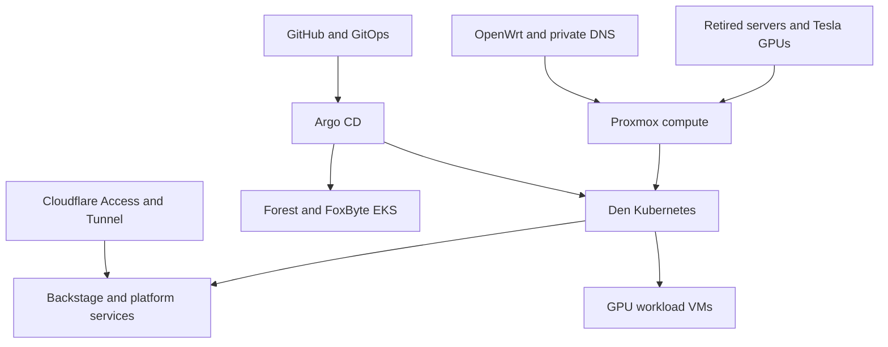

# Forest Reforge

### Retired hardware. Modern infrastructure. A second life, engineered.

**Build a hybrid datacenter from the machines the industry left behind.**

Forest Reforge is a field guide to turning second-hand enterprise servers, passive NVIDIA Tesla accelerators, modest networking equipment, and a home rack into a useful platform for virtual machines, Kubernetes, AI experiments, and AWS-connected services.

Born in **Mr. Foxxo’s den**, part of Enchanted Forest Inc., it follows the whole path: rails and airflow → trustworthy hardware → isolated networks → virtual compute → Kubernetes → identity → GitOps → cloud integration → recovery.

The point is not to pretend an old GPU is a new one. It is to understand its limits well enough to give it useful work.

> **Automation iteration · 2026-10-27.** Modular guides now include generic Ansible configurations, installation and integration helpers, GPU/kernel diagnostics and an isolated legacy-console bundle. Start with the [automation guide](docs/automation.md) and a private site contract. The implementation was checked offline; no infrastructure deployment is claimed.

## What you can build

- A physically segmented lab using OpenWrt and separate switches, without requiring VLAN trunks.
- Proxmox hosts with recoverable upgrade procedures and a deliberate GPU passthrough/vGPU strategy.
- A kubeadm cluster with Cilium, kube-vip, Gateway API, TLS, local storage, and observability.
- A developer portal with GitHub organization identity and Cloudflare Access.
- An on-prem Argo CD control point for local workloads and separate AWS EKS targets.
- A measured legacy GPU compute pool that records what works—and what does not.

## Start here

1. Read the [architecture and evidence policy](docs/architecture.md).
2. Choose a [build path](docs/build-paths.md); you do not need two servers or AWS to begin.
3. Fill in the [site contract](examples/site-contract.md) and [version record](examples/validated-stack.md).
4. Follow the modules in dependency order below.
5. Run the [acceptance and recovery exercises](docs/acceptance.md).

The [automation guide](docs/automation.md) provides phased setup commands, private inventory/vault examples, service prerequisites, AWS access/ECR renewal, recovery and rollback guidance. The [reference-to-automation map](docs/automation-source-map.md) explains what was carried forward from the source playbooks and chats. Target versions and credentials are deliberate local inputs.

## The modules

| Module | What it teaches | Exit condition |
|---|---|---|
| [01 · Roots](modules/01-roots-physical.md) | Rack, power, cooling, cabling, reused hardware | Stable physical platform and inventory |
| [02 · Forge](modules/02-forge-hardware.md) | R710, X99, RAM, firmware, OOB recovery | Hardware passes repeatable tests |
| [03 · Paths](modules/03-paths-network.md) | OpenWrt zones, routing, WireGuard | Allowed and forbidden paths tested |
| [04 · Names](modules/04-names-dns-tls.md) | Split DNS, ACME, wildcard boundaries | Trusted canonical names |
| [05 · Burrows](modules/05-burrows-proxmox.md) | Hypervisors, VM templates, storage | Restorable guests |
| [06 · Embers](modules/06-embers-gpu.md) | Tesla P4/V100/M40, CUDA, passthrough, vGPU | One recorded working GPU stack |
| [07 · Canopy](modules/07-canopy-kubernetes.md) | kubeadm, Cilium, VIPs, Gateway API | Cluster and external route acceptance |
| [08 · Vault](modules/08-vault-storage-secrets.md) | LocalPV, data services, secret ownership | Restore and rotation demonstrated |
| [09 · Gatehouse](modules/09-gatehouse-identity-edge.md) | GitHub, Cloudflare, application identity | Login and rejection both proven |
| [10 · Trails](modules/10-trails-gitops-backstage.md) | Argo CD, Backstage, delivery ownership | Commit becomes an authorized deployment |
| [11 · Skybridge](modules/11-skybridge-aws.md) | AWS accounts, VPN, EKS, ECR | Least-privilege cross-account delivery |
| [12 · Lookout](modules/12-lookout-operations.md) | Metrics, logging, backup, cost, upgrades | Recovery works without the portal |
| [13 · Spellwork](modules/13-spellwork-ai.md) | Legacy GPU inference and benchmark design | Reproducible workload results |

## The hardware at the heart of the project

| Resource | Role in the originating den | Reuse lesson |
|---|---|---|
| Dell PowerEdge R710, dual X5690 | Foundational virtualization, Tesla P4 experiments | CPU instruction set, risers and cooling matter |
| Dual-socket X99 host | Larger compute host, Tesla V100 | Qualify mixed memory before software debugging |
| NVIDIA Tesla P4 | Compact Pascal compute | Official vGPU support ends at branch 16 |
| NVIDIA Tesla V100 | Volta compute | Current AI packages can still exclude it |
| NVIDIA Tesla M40 | Available experimental Maxwell capacity | No official NVIDIA vGPU support; evaluate passthrough |
| Banana Pi R3 + Raspberry Pi 4 | Routing/firewall and independent DNS | Keep recovery dependencies outside Kubernetes |
| Separate switches | Physical trust boundaries | Simple segmentation can be sufficient |

Read the [compatibility matrix](docs/compatibility.md) before buying or installing. GPU generation, driver branch, hypervisor kernel, guest OS, CUDA build, and application kernels form one compatibility chain.

## What is honest about this repository

**Source-reported** means the supplied notes say it happened. **Proposed** means a reproducible design offered here. **Experimental** means unsupported or unvalidated combinations. **Unknown** means evidence is missing. None is silently promoted to a tested deployment.

The [decision register](docs/decisions.md) resolves conflicting generations of the design. The local reference tree preserves all 26 project source files and both chat exports, including the original policy fragment. They are evidence, not an installation sequence. The release helper excludes historical references and the raw on-prem source, keeping private inventories and deployment artifacts out of the generic archive.

Exact rack dimensions, electrical measurements and final applied GPU patch diffs were not available. Two full technical chat exports were added; other past chats remain partial context. The guides provide procedures and capture sheets for those gaps rather than invented build history.

## Project and resource names

- **Project:** Forest Reforge
- **Suggested public repository:** `forest-reforge` (name availability not checked)
- **Tagline:** Retired hardware. Modern infrastructure.
- **Site:** `den`; **cluster:** `core`; **example domain:** `example.net`
- **Portable hosts:** `hv01`, `hv02`, `gw01`, `dns01`, `core-cp01`, `core-wk01`
- **Optional personality:** keep Deerly/Foxy as inventory aliases, while automation uses role-based names.

The module names are navigation aids. They are not extra products to deploy. See the [naming convention](docs/naming.md).

## Useful next reads

[Build paths](docs/build-paths.md) · [Lab case study](docs/den-case-study.md) · [Troubleshooting](docs/troubleshooting.md) · [R710/P4 runbook](docs/r710-p4-vgpu-runbook.md) · [DRAC5 on Apple Silicon](docs/drac5-apple-silicon-runbook.md) · [Automation boundary](docs/automation.md) · [Diagram assets](assets/architecture.md) · [Source coverage](reference/README.md) · [Upstream references](docs/upstream.md)

Contributions should include exact versions and evidence. See [CONTRIBUTING.md](CONTRIBUTING.md). Public release preparation is tracked in [RELEASE.md](RELEASE.md).
