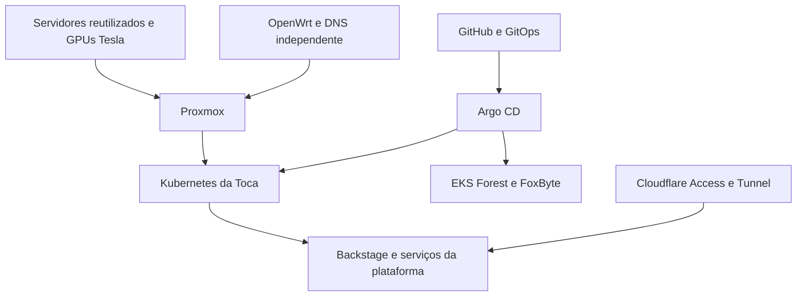

# Forest Reforge

[English (default)](README.md) | [Português (Brasil)](README.pt-BR.md) | [Índice](docs/pt-BR/README.md)

### Hardware aposentado. Infraestrutura moderna. Uma segunda vida, com engenharia.

**Construa um datacenter híbrido com máquinas que a indústria deixou para trás.**

Forest Reforge reúne um guia prático e ferramentas de configuração para transformar servidores corporativos usados, aceleradores passivos NVIDIA Tesla, equipamentos de rede acessíveis e um rack doméstico em uma plataforma de máquinas virtuais, Kubernetes, inteligência artificial e serviços conectados à AWS.

Nascido na **Toca do Sr. Raposo**, parte da Enchanted Forest Inc., o projeto percorre: montagem e refrigeração → validação do hardware → redes isoladas → virtualização → Kubernetes → identidade → GitOps → nuvem → recuperação.

O inglês é o idioma padrão. Esta edição em português do Brasil oferece guias adaptados para consulta e implantação; os documentos correspondentes em inglês preservam o detalhamento integral. Comandos, identificadores e arquivos de configuração são compartilhados pelos dois idiomas.

## Comece por aqui

1. Leia a [arquitetura e a política de evidências](docs/pt-BR/architecture.md).
2. Escolha um [caminho de implantação](docs/pt-BR/build-paths.md); dois servidores e AWS são opcionais.
3. Preencha o [contrato do ambiente](docs/pt-BR/examples/site-contract.md) e o [registro de versões e resultados](docs/pt-BR/examples/validated-stack.md).
4. Siga os módulos na ordem abaixo, validando cada camada antes de avançar.
5. Execute os [testes de aceitação e recuperação](docs/pt-BR/acceptance.md).

O [índice em português](docs/pt-BR/README.md) reúne todos os guias, módulos e exemplos. O [guia de automação](docs/pt-BR/automation.md) explica inventários, entradas privadas, fases e responsabilidades. Use o [inventário inicial](automation/ansible/inventory.example.yml) ou o [inventário do tamanho da Toca](automation/ansible/inventory.observed.example.yml), escolhendo endereços, credenciais e versões no ambiente privado.

## O que você pode construir

- Laboratório segmentado com OpenWrt e switches separados, sem exigir troncos VLAN.
- Hosts Proxmox com atualização recuperável e uma estratégia explícita de passthrough ou vGPU.
- Cluster kubeadm com Cilium, kube-vip, Gateway API, TLS, armazenamento local e observabilidade.
- Portal Backstage com identidade GitHub e Cloudflare Access.
- Argo CD local para aplicações da Toca e destinos AWS EKS separados.
- Ambiente de computação com GPUs antigas e registros reproduzíveis de workloads e benchmarks.

## Os módulos

| Módulo | Conteúdo | Condição de conclusão |
|---|---|---|
| [01 · Roots](docs/pt-BR/modules/01-roots-physical.md) | Rack, energia, refrigeração e cabos | Plataforma física estável e inventariada |
| [02 · Forge](docs/pt-BR/modules/02-forge-hardware.md) | R710, X99, memória, firmware e console | Hardware aprovado em testes repetíveis |
| [03 · Paths](docs/pt-BR/modules/03-paths-network.md) | OpenWrt, roteamento e WireGuard | Caminhos permitidos e bloqueados testados |
| [04 · Names](docs/pt-BR/modules/04-names-dns-tls.md) | DNS dividido, ACME e certificados | Nomes canônicos com TLS confiável |
| [05 · Burrows](docs/pt-BR/modules/05-burrows-proxmox.md) | Proxmox, templates e armazenamento | Máquinas virtuais restauráveis |
| [06 · Embers](docs/pt-BR/modules/06-embers-gpu.md) | P4/V100/M40, CUDA, passthrough e vGPU | Uma combinação de GPU validada e registrada |
| [07 · Canopy](docs/pt-BR/modules/07-canopy-kubernetes.md) | kubeadm, Cilium, VIPs e Gateway API | Cluster e acesso externo aprovados |
| [08 · Vault](docs/pt-BR/modules/08-vault-storage-secrets.md) | LocalPV, dados e segredos | Restauração e rotação demonstradas |
| [09 · Gatehouse](docs/pt-BR/modules/09-gatehouse-identity-edge.md) | GitHub, Cloudflare e identidade | Acesso autorizado e rejeição comprovados |
| [10 · Trails](docs/pt-BR/modules/10-trails-gitops-backstage.md) | Argo CD, Backstage e entrega | Commit gera implantação autorizada |
| [11 · Skybridge](docs/pt-BR/modules/11-skybridge-aws.md) | Contas AWS, VPN, EKS e ECR | Entrega entre contas com privilégio mínimo |
| [12 · Lookout](docs/pt-BR/modules/12-lookout-operations.md) | Métricas, logs, backups e custos | Recuperação funciona sem o portal |
| [13 · Spellwork](docs/pt-BR/modules/13-spellwork-ai.md) | Inferência e benchmarks em GPUs antigas | Resultados reproduzíveis |

## Hardware e compatibilidade

O ambiente de origem inclui R710 com dois X5690 e P4, um host X99 com V100, hipervisores de infraestrutura Dell PowerEdge T310/T410, NAS PowerEdge 2950, capacidade adicional M40, Banana Pi R3, Raspberry Pi 4 e switches separados. T310/T410 não hospedam nós Kubernetes. O X5690 não possui AVX; refrigeração, risers, instruções da CPU e versões dos drivers fazem parte da validação.

Consulte a [matriz de compatibilidade](docs/pt-BR/compatibility.md) antes de comprar ou instalar. Suporte à GPU, kernel, driver, sistema convidado, toolkit CUDA, framework e kernels da aplicação precisam funcionar como uma única combinação.

## Plataforma e evidências

O [registro da Toca](docs/pt-BR/den-case-study.md) e o [snapshot estruturado](examples/observed-platform.json) documentam o ambiente observado. A revisão de 28/10/2026 registra quatro hipervisores Proxmox e um NAS TrueNAS; apenas dois hipervisores hospedam os nós Kubernetes. São cinco control planes e oito workers Ready com kubelet v1.36.4. O painel restrito aos workers mostra 64 CPU e 124,1 GiB de RAM alocável.

A [revisão do inventário em 30/10/2026](docs/pt-BR/den-inventory.md) acrescenta alocações declaradas para as treze VMs: 14 vCPU nos control planes e 64 nos workers, com nota Tesla V100 em core-wk05. A coluna RAM da fonte não informa unidade; seus valores são preservados separadamente das medições em GiB. O guia apresenta plataformas, infraestrutura/OOB, posicionamento e conciliação dos recursos nos dois idiomas.

Esses números não comprovam restauração, execução de modelos ou tolerância à perda de qualquer host. O [registro de validações e experimentos](docs/pt-BR/den-validations-experiments.md) distingue observações e próximos testes. O [relatório de validação](docs/pt-BR/package-validation.md) descreve verificações do repositório, sintaxe Ansible, templates e empacotamento.

## Organização e contribuições

Os documentos em inglês permanecem em `docs/`, `modules/`, `examples/` e `assets/`. As alternativas brasileiras ficam em `docs/pt-BR/`, com os mesmos nomes de arquivo para facilitar a correspondência. Scripts, configurações, imagens e JSON não são duplicados. Nomes como Roots e Canopy são referências de navegação, sem produtos adicionais para instalar.

Use nomes públicos baseados em função (`hv01`, `gw01`, `dns01`, `core-cp01`), domínio `example.net` e entradas privadas em `local/`. Consulte as [convenções de nomes](docs/pt-BR/naming.md), o [guia de contribuição](CONTRIBUTING.pt-BR.md) e as [notas de release](RELEASE.pt-BR.md).

## Próximas leituras

[Automação](docs/pt-BR/automation.md) · [Solução de problemas](docs/pt-BR/troubleshooting.md) · [R710/P4](docs/pt-BR/r710-p4-vgpu-runbook.md) · [DRAC5 no Apple Silicon](docs/pt-BR/drac5-apple-silicon-runbook.md) · [Diagramas](docs/pt-BR/assets/architecture.md) · [Referências](docs/pt-BR/upstream.md)

## Licença

Distribuído sob a [GNU General Public License v3.0](LICENSE). O arquivo `LICENSE` mantém o texto original da licença.
