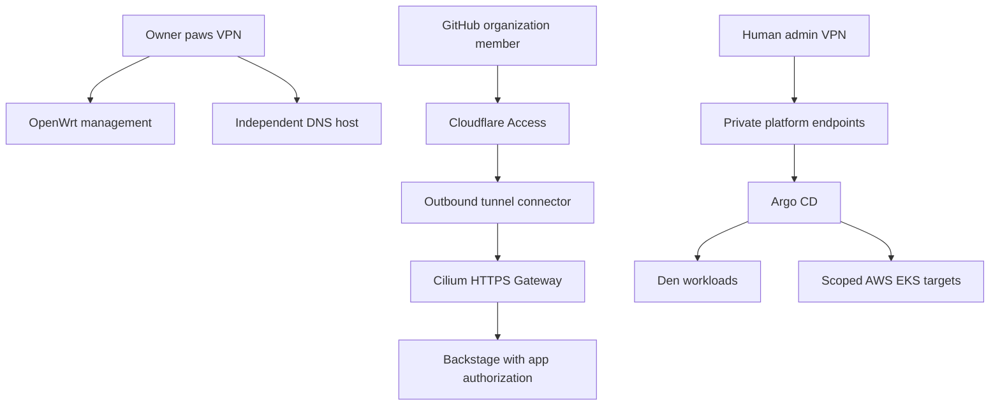
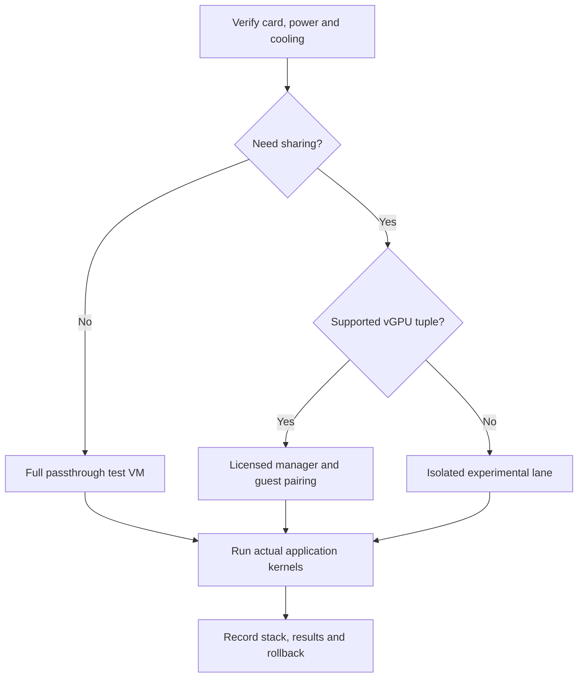
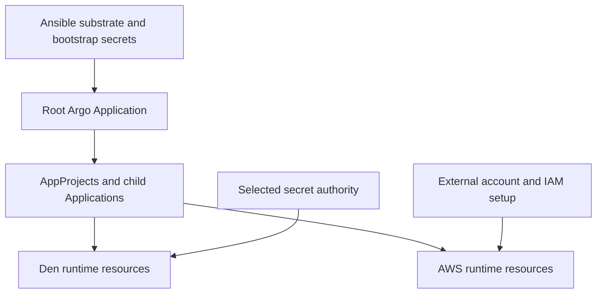

# Forest Reforge diagram assets

[English (default)](architecture.md) | [Português (Brasil)](../docs/pt-BR/assets/architecture.md) | [Documentation index](../docs/README.md)

These source-native Mermaid assets render on GitHub. They are deliberately Markdown rather than fabricated rack photographs or generated logos.

## Trust and delivery topology

Absence of an edge here is not a firewall specification; use the explicit access matrix in Module 03.

## GPU qualification decision

## Reconciliation ownership

