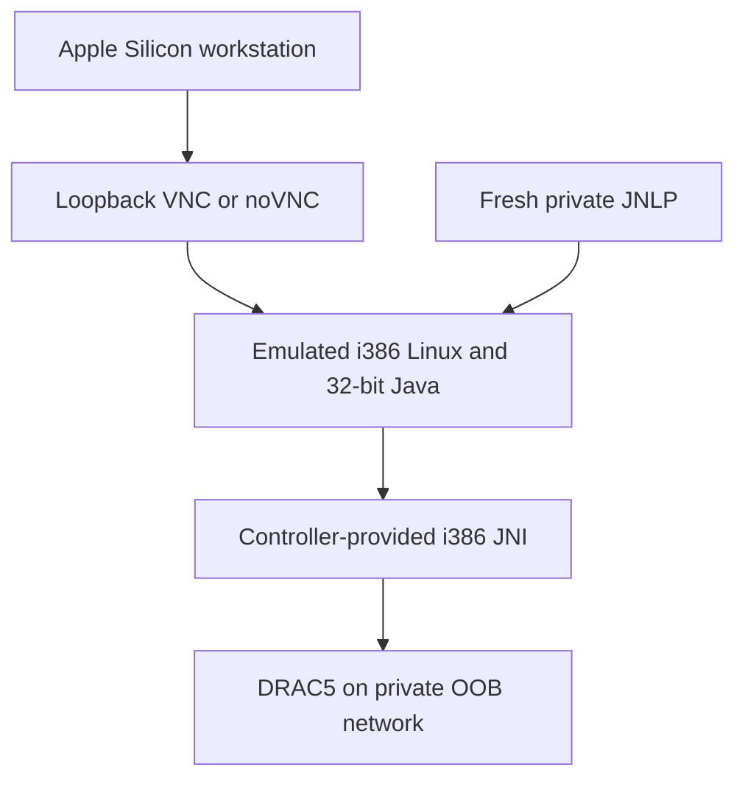

# DRAC5 console on Apple Silicon: recovered working path

## Confirmed versus proposed

The September 12 export contains actual controller responses, JAR listings and `file` output. The owner confirmed VNC worked, then confirmed enabling the keyboard option worked. The final credential-only Playwright fetcher was proposed in an earlier ZIP, but that ZIP's bytes were not attached here and the chat contains no later successful automation test.

This guide therefore documents the **confirmed manual fresh-JNLP + 32-bit viewer path**, plus a separate automation contract. It does not claim a tested automatic login implementation.

## What failed and why it mattered

| Observation | Evidence/conclusion |
|---|---|
| `/rpc/WEBSES/create.asp` returned 404 | Wrong controller-generation login assumption |
| `/cgi-bin/webcgi/login` produced authenticated `/main` redirect | DRAC5 web-session flow was identified |
| Session cookie was `sid`, not expected `0x3000` | Reuse a cookie jar; do not hard-code unrelated cookie names |
| Main page was XML with imported XSL | Console controls came from XSL/JavaScript, not a flat HTML scrape |
| `curl` rejected `DEFAULT:@SECLEVEL=0` | TLS backend-specific flag was not portable to that curl build |
| `libavctKVMIO.so` was ELF32 Intel 80386 | Viewer requires matching 32-bit x86 JVM/userspace |
| macOS VNC failed with the initial no-password setup | Password-authenticated x11vnc path subsequently worked |
| Menus received keyboard but remote canvas did not | Viewer keyboard capture needed enabling |

A build-stage `unable to find user root` error and an unmatched shell command-substitution delimiter were also recorded. These were container/script construction failures, not BMC authentication evidence. Numeric UID handling was suggested for that specific base image; do not generalize it to all containers.

## Architecture



The observed `avctKVMIOLinux.jar` contains `libavctKVMIO.so`. Java bytecode portability does not make its native library portable. Neither an ARM64 JVM nor an amd64 JVM can load that 32-bit i386 library. Check emulation capability on the current Docker environment; do not assume Rosetta alone provides the needed 32-bit Linux execution.

## Reproduce the working viewer path

1. Reach the DRAC5 web interface through the approved OOB route. Keep it off public ingress.
2. Log in normally, choose **Console → Console Redirect → Connect**, and download a fresh `vkvm.jnlp`. Keep the browser session alive as required by that firmware.
3. Inspect the JNLP privately. The observed main class is `com.avocent.drac5.kvm.Main`; its `user` argument is a temporary console token, not necessarily the account username. Never publish it.
4. Fetch the exact viewer/native JARs from the same authenticated controller/session: `plugins/vkvm/avctDRAC5Viewer.jar` and `plugins/vkvm/avctKVMIOLinux.jar`. Verify archive validity and record hashes privately.
5. Extract and inspect the native library. Validate a 32-bit x86 runtime and JVM, plus its required shared libraries.
6. Start a virtual X display/window manager and x11vnc in the isolated viewer environment. Bind the published VNC port only to workstation loopback; configure a private password instead of the earlier `-nopw` experiment.
7. Launch the viewer with its native library path and argument array parsed from JNLP. Preserve argument boundaries; avoid unquoted shell interpolation or printing credentials.
8. Open macOS Screen Sharing to `vnc://127.0.0.1:5900`; use the configured VNC password, which is separate from the DRAC login password.
9. In the Java viewer choose **Tools → Session Options → General → Pass all keystrokes to target → OK**. This is the user-confirmed keyboard fix.
10. Test BIOS/navigation keys and the required OS installer interactions. Use the viewer's macro mechanism for special combinations intercepted by the workstation. Renew JNLP when session authorization expires.

### Diagnostic commands inside the prepared viewer environment

```bash
getconf LONG_BIT
java -version
file /opt/drac5/native/libavctKVMIO.so
ldd /opt/drac5/native/libavctKVMIO.so
```

Expected native-library architecture is ELF32/i386. `ldd` must not report missing required libraries. If the keyboard setting is disabled or raises an error, investigate JNI loading before changing networking. If keyboard reaches Java menus, VNC already carries some keyboard input; focus on the Avocent capture layer.

## Transport and legacy TLS

The captured JNLP uses controller ports 5900 for keyboard/mouse and 5901 for video. The local VNC port 5900 is a separate hop; opening it on the workstation does not prove the container can reach the BMC's ports. Resolve the JNLP's hostname inside the container, using private DNS or a deliberate local host mapping.

Historical examples disabled broad Java algorithm restrictions and used `curl -k`. They remain archive evidence, not the new default. Scope any unavoidable legacy protocol/certificate exception to this disposable single-purpose runtime and the intended controller. Preserve trust through a pinned certificate/manual fingerprint where feasible; never weaken the workstation globally or browse arbitrary sites from this runtime.

## Convenience automation contract

The final proposed stack had a native browser fetcher, legacy i386 viewer, and separate modern noVNC service. The fetcher would log in, navigate the real DRAC5 frames, click Connect and capture the generated JNLP. It was not independently tested in the exported conversation.

Implement only after the manual viewer path works. Store runtime cookies/JNLP in a private short-lived directory; pass credentials through protected local files/secret mechanisms; redact screenshots/HTML/debug logs; reuse the working viewer unchanged; preserve Java preferences only if that implementation actually persists the keyboard option. Keep manual JNLP renewal as fallback. Never add a claim that the unprovided older ZIP is included here.

## Cleanup and acceptance

Stop the legacy container when unused, delete expired session artifacts and rotate any credentials exposed during debugging. Accept the setup only after video, pointer, keyboard, reboot/reconnect and required virtual-media access are independently tested. Virtual-media success was not shown in this chat.

References: [sanitized chat](../reference/chat-history/drac5-apple-silicon.md), [Dell keyboard procedure](https://www.dell.com/community/en/conversations/networking-internet-bluetooth/custom-drac5-macros/647e730cf4ccf8a8decf9a29), [Docker multi-platform execution](https://docs.docker.com/build/building/multi-platform/).
