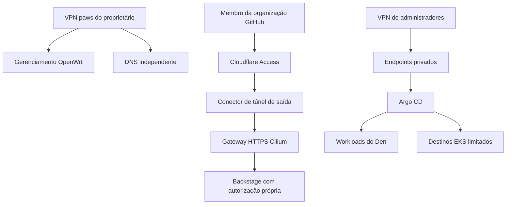
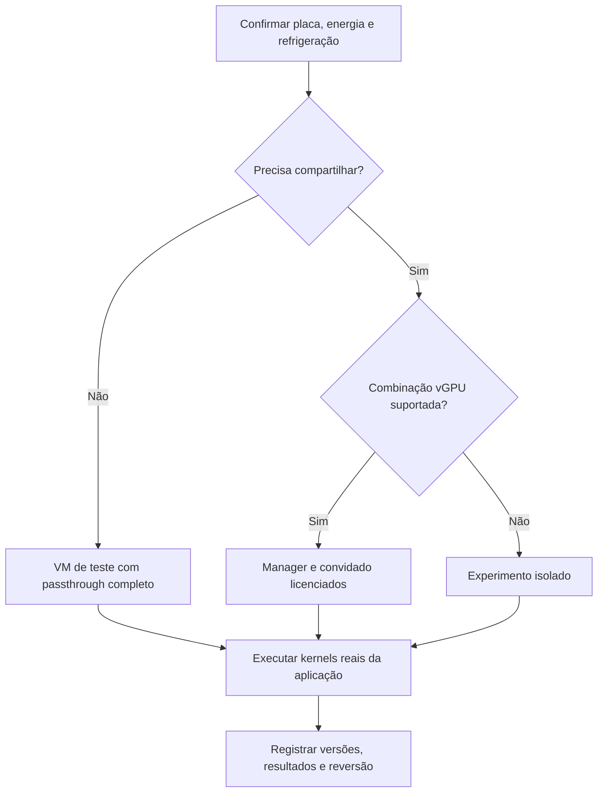
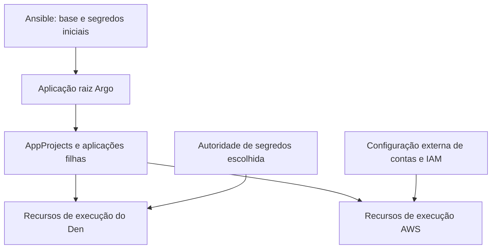

# Diagramas do Forest Reforge

[English (default)](../../../assets/architecture.md) | [Português (Brasil)](architecture.md) | [Índice](../README.md)

Fontes Mermaid renderizáveis no GitHub, compartilhando o mesmo desenho conceitual da edição inglesa. O texto dos diagramas está em português.

## Confiança e entrega

Ausência de seta não especifica regra de firewall. Use a política explícita do [módulo 03](../modules/03-paths-network.md).

## Decisão de qualificação GPU

## Responsabilidade pela reconciliação

Defina um responsável por objeto e registre a transferência Ansible → Argo conforme [automação](../automation.md).
