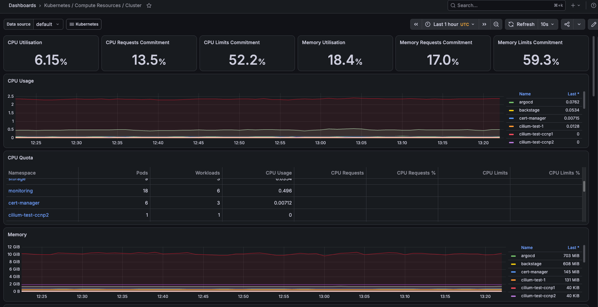
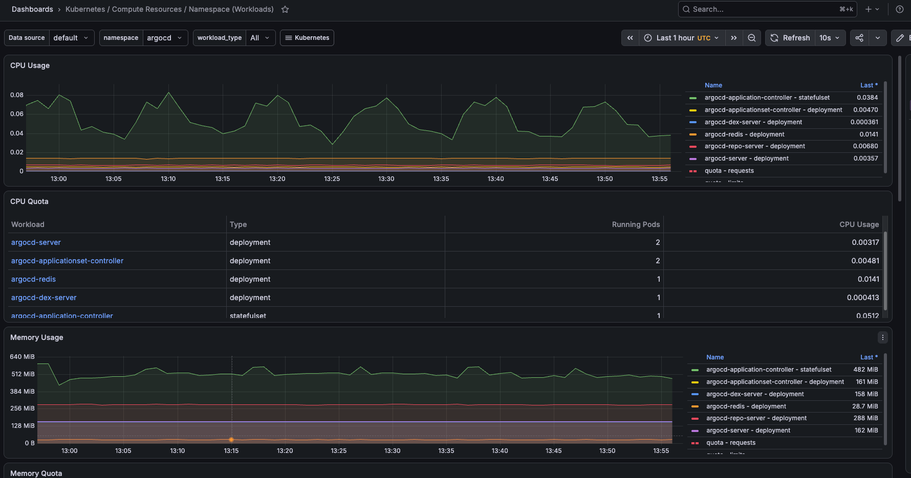

# Validações e experimentos do Den

[English (default)](../den-validations-experiments.md) | [Português (Brasil)](den-validations-experiments.md) | [Índice](README.md)

As dez vistas complementares ampliam as sete imagens da base. Eixos Proxmox indicam 28/10/2026; Grafana preserva intervalos UTC próprios. Dois originais revisados estão em assets; as demais vistas têm informações privadas e permanecem locais. O [manifesto](../../assets/evidence.json) registra integridade.

## Posicionamento de VMs e domínios de falha

| Host | Control planes | Workers | Observação |
|---|---|---|---|
| hv01 | cp01–03 | wk01–04 | Standalone, oito VMs em execução, incluindo uma de gerenciamento; um template |
| hv02 | cp04–05 | wk05–08 | Standalone, seis VMs em execução; um template |
| hv03/hv04 | Nenhum | Nenhum | Infraestrutura fora da capacidade Kubernetes |

Templates não são nós em execução. Com cinco votantes etcd, a divisão três/dois é assimétrica: perder hv01 elimina maioria; perder hv02 preserva três. Confirme membership e teste com recuperação antes de declarar resiliência. Um terceiro domínio físico independente é necessário para sustentar a proposta de tolerância a qualquer um dos dois hosts.

Indicadores Proxmox mostram usado/total de 1,44/3,38 TiB e 1,07/3,24 TiB. Podem incluir backing compartilhado/duplicado; não some como capacidade física única ou backup garantido.

## Monitoramento e recursos do cluster

Painel Cluster, última hora UTC, distinto do painel inicial restrito aos workers. Uso CPU 6,15%; requests 13,5%; limits 52,2%. Uso RAM 18,4%; requests 17,0%; limits 59,3%. Tabela de namespaces: monitoring com 18 pods/6 workloads; cert-manager com 6 pods/3 workloads.

Outro painel de seis horas mostra requests de RAM 27,7 GiB e uso 40,9 GiB; a legenda de alocável está cortada. Não infira o valor nem combine escopos para calcular capacidade livre. Registre query, filtros, janela e unidades ao reproduzir.

## Recursos de um control plane

A vista de core-cp01 exibe 2 CPU capacity/allocatable e memória 7,76/7,66 GiB. Não define tamanho dos outros doze nós. Séries de Cilium, Envoy, etcd, kube-controller-manager e node-feature-discovery demonstram atividade de componentes, sem provar execução GPU.

## Execução do Argo CD

Namespace `argocd`, última hora UTC: server 2 pods, ApplicationSet 2, Redis 1, Dex 1, application-controller 1. Repo-server aparece em séries, mas sua linha de réplicas não está visível. Não invente a contagem. Atividade não comprova sync, login, rejeição ou entrega entre contas.

## Próximos experimentos

| Área | Verificação seguinte |
|---|---|
| Hosts/etcd | Reconciliar configurações/membros, testar falha em janela com backup |
| Métricas | Reproduzir queries e executar carga limitada com limites de parada |
| Argo | Commit descartável, destino proibido, autenticação e rollback |
| GPU | Identidade PCI, driver, alocação, licença e kernels CUDA/modelo |
| NAS | Exportação, permissões, backup e restauração isolada |
| Bootstrap | Ambiente descartável e contrato completo com versões fixadas |

Preserve a classificação de cada resultado no [registro da plataforma](den-case-study.md) e execute os [testes de aceitação](acceptance.md). Descoberta de dispositivos não equivale à capacidade de executar uma aplicação.
